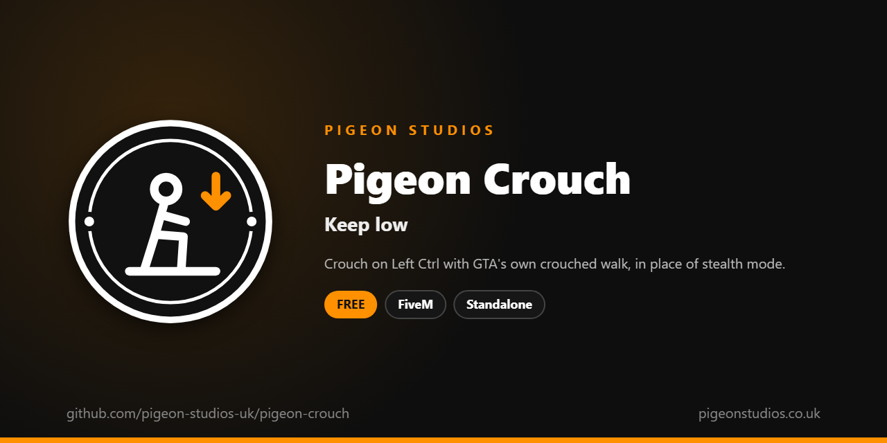

<div align="center">
  

  <h1>Pigeon Crouch</h1>

  <p><strong>Crouch on Left Ctrl with GTA's own crouched walk and aim, in place of stealth mode, synced for everyone.</strong></p>

  <p>
    <a href="https://github.com/pigeon-studios-uk/pigeon-crouch/releases/latest"></a>
    <a href="LICENSE.md"></a>
    <a href="https://discord.gg/2NFVWEUmDF"></a>
    
  </p>

  <p>
    <a href="https://github.com/pigeon-studios-uk/pigeon-crouch/releases/latest"><strong>Download</strong></a> ·
    <a href="#installation">Install</a> ·
    <a href="#configuration">Configure</a> ·
    <a href="CHANGELOG.md">Changelog</a> ·
    <a href="https://discord.gg/2NFVWEUmDF">Support</a>
  </p>
</div>

---

## Contents

- [Overview](#overview)
- [Features](#features)
- [Requirements](#requirements)
- [Installation](#installation)
- [Updating](#updating)
- [Configuration](#configuration)
- [Localisation](#localisation)
- [Commands and exports](#commands-and-exports)
- [How it works](#how-it-works)
- [Update checker](#update-checker)
- [Performance](#performance)
- [Security](#security)
- [Troubleshooting](#troubleshooting)
- [FAQ](#faq)
- [Support](#support)
- [Contributing](#contributing)
- [Licence](#licence)
- [Credits](#credits)

## Overview

Pigeon Crouch is a free resource by [Pigeon Studios](https://pigeonstudios.co.uk) that lets players crouch. GTA Online's stealth mode, the hunched creep you get from Ctrl, looks out of place in roleplay, and GTA has no crouch of its own on a key. This resource puts one there: press Left Ctrl to crouch down with GTA's own crouched walk, and again to stand up.

Players can walk, run and aim while crouched, and everyone sees it. Ctrl's stealth mode is turned off on foot so the two don't fight, and getting into a vehicle, swimming, falling, climbing, ragdolling or dying stands the player up.

## Features

- **One key.** Left Ctrl by default, which players can change in GTA's key bindings, or `/crouch`.
- **GTA's own animations.** The crouched walk and crouched aiming from the game, synced for everyone.
- **In place of stealth mode.** Ctrl only crouches on foot. Or keep stealth mode and use another key.
- **No crouch-jumping.** Jumping is turned off while crouched, or allowed if you prefer.
- **Stays crouched.** If another resource resets the walk, for example when changing weapons, it's put back.
- **Stands up by itself.** Vehicles, water, falling, climbing, ragdolls and death stand the player up.
- **Works with cuffs, carrying and walk styles.** A state bag, exports and an event for other resources.
- **23 languages.** Follows ox_lib's language, or set your own.
- **Standalone.** No framework or other resources needed.

## Requirements

| Requirement | Version | Notes |
|---|---|---|
| FXServer | A [recommended artifact](https://runtime.fivem.net/artifacts/) | |
| [ox_lib](https://github.com/communityox/ox_lib) | Optional | Used for the language if it's running |

**Frameworks:** none needed. It works the same on standalone and vMenu servers, ESX Legacy, QBCore, Qbox and ox_core.

## Installation

1. **Download** `pigeon-crouch.zip` from the [latest release](https://github.com/pigeon-studios-uk/pigeon-crouch/releases/latest). Don't use the green **Code** button; release zips are the tested builds.
2. **Extract** it into your server's `resources` folder. The folder must be called `pigeon-crouch`.
3. **Start it** by adding this to `server.cfg`, after ox_lib if you use it:

   ```cfg
   ensure pigeon-crouch
   ```

4. **Configure** it in `configuration/config.lua` if you want to change anything. The defaults work as they are.
5. **Restart** your server. The console shows one line from the update checker:

   ```text
   [Pigeon Studios] Pigeon Crouch v1.0.0 is up to date.
   ```

## Updating

1. Read the [changelog](CHANGELOG.md) for every version between yours and the latest, especially any **Upgrade notes**.
2. Back up your `configuration/` and `locales/` folders.
3. Replace the `pigeon-crouch` folder with the new release.
4. Copy your changed settings into the new `configuration/config.lua`. Don't copy the old file over the new one; new versions can add settings.
5. Restart the resource.

## Configuration

All settings are in `configuration/config.lua`, each explained by a comment next to it.

| Setting | Default | What it does |
|---|---|---|
| `Config.Locale` | `'auto'` | The language of the key binding's name. `'auto'` follows ox_lib's; or a code such as `'de'` (see [Localisation](#localisation)) |
| `Config.Key` | `'LCONTROL'` | The default key. Players can change it in GTA's key bindings |
| `Config.Command` | `'crouch'` | The command, which the key runs |
| `Config.ReplaceStealth` | `true` | Turn off Ctrl's stealth mode on foot, so Ctrl only crouches. `false` keeps it (use another key then) |
| `Config.BlockJump` | `true` | Players can't jump while crouched. `false` lets them |

## Localisation

Pigeon Crouch comes in 23 languages: `en` English, `cs` Czech, `da` Danish, `de` German, `es` Spanish, `et` Estonian, `fi` Finnish, `fr` French, `hr` Croatian, `hu` Hungarian, `id` Indonesian, `it` Italian, `nl` Dutch, `no` Norwegian, `pl` Polish, `pt` Portuguese, `pt-br` Brazilian Portuguese, `ro` Romanian, `sl` Slovenian, `sv` Swedish, `tr` Turkish, `zh-cn` Simplified Chinese and `zh-tw` Traditional Chinese. They're the languages ox_lib ships, so your server may already have one set.

With `Config.Locale = 'auto'` (the default), it uses ox_lib's language, so one line in `server.cfg` sets it for this and every other resource that follows ox_lib:

```cfg
setr ox:locale "de"
```

Use `setr`, not `set`, so players' games get it too. Without it, or for a language that isn't in `locales/`, the text is English. To choose a language for this resource only, set `Config.Locale` to its code, such as `'fr'` or `'pt-br'`.

The only text is the key binding's name in GTA's settings, which is set the first time a player joins, in the language the server had then. Chinese text can show as blank in GTA's own text, such as its notifications, because GTA only loads its Chinese font when the game itself is set to Chinese. ox_lib's notifications show every language.

Every file was checked for missing text and placeholders, but not every translation has been read by a native speaker yet. If something reads wrong, please send a fix; see [Contributing](#contributing). To add a language, copy `locales/en.lua` to a new file named with the language's code (such as `ja.lua`), change `Locales.en` at the top to match (`Locales.ja`), and translate the text in quotes.

## Commands and exports

### Commands

| Command | Who | What it does |
|---|---|---|
| `/crouch` | Everyone | Crouch, or stand up again. The Left Ctrl key runs it |

### Exports

Client exports, for other resources in the player's game:

```lua
-- True while the player is crouched.
local crouched = exports['pigeon-crouch']:IsCrouching()

-- Stop the player crouching (true), for example while handcuffed or being carried, or let them again
-- (false). Blocking while they're crouched stands them up.
exports['pigeon-crouch']:SetBlocked(true)
```

### Event

A local client event when the player crouches (`true`) or stands up (`false`). Standing up puts GTA's default walk back, so a walk style resource can listen for it and put the player's walk style back:

```lua
AddEventHandler('pigeon-crouch:changed', function(crouched)
    if not crouched then
        -- put the player's walk style back here
    end
end)
```

### State bag

Every player has a replicated `crouching` state bag, so the server and other players' resources can read it too. It's `true` or `nil`:

```lua
-- Server
local crouched = Player(source).state.crouching
```

## How it works

When the player presses the key, the resource checks they're on foot and not swimming, falling, climbing, ragdolled, parachuting or dead. It loads GTA's crouched animations and sets them as the character's walk (`move_ped_crouched`) and aim (`move_ped_crouched_strafing`), and ends stealth mode if they were in it.

While crouched, every frame it turns off jumping (with `Config.BlockJump`), checks the crouched walk is still set and puts it back if another resource changed it, and stands the player up if they can't stay crouched. Standing up puts GTA's default walk and aim back. There's half a second between crouching and standing, so the key can't be spammed.

With `Config.ReplaceStealth`, Ctrl's stealth mode is turned off whenever the player is on foot, so pressing Ctrl only crouches. In vehicles, Ctrl does what it normally does.

Walk animations are synced by the game itself, so everyone sees players crouch. The only thing the resource shares is the `crouching` state bag.

## Update checker

When it starts, Pigeon Crouch checks our public [version registry](https://github.com/pigeon-studios-uk/pigeon-versions) once and prints one line in the server console saying whether it's up to date. If there's an update, it shows what's new and where to get it. The check is a single request to GitHub and sends nothing about your server or players.

Control it for every Pigeon Studios resource at once in `server.cfg`:

```cfg
set pigeon_update_check "on"      # default: one line per resource
set pigeon_update_check "quiet"   # only when there's an update or a problem
set pigeon_update_check "off"     # never check
```

## Performance

On foot, with `Config.ReplaceStealth` on, it turns off one control each frame, which costs next to nothing. With it off, nothing runs while standing apart from a check four times a second. While crouched, it runs a few checks each frame. Nothing runs on the server apart from the update check at start-up.

## Security

- It runs only in each player's own game and only changes their own character.
- It has no network events, so there is nothing other players or the server can send it. The exports and the event are only for resources in the player's own game.
- The `crouching` state bag is set by the player's own game, so treat it like anything else a player's game says: fine for roleplay and stealth checks, but don't base anything important on it alone.
- The only network request is the update check at start-up, from the server to GitHub. It sends nothing about your server or players.

Found a problem? Please don't open a public issue. Use the **Report a vulnerability** button in this repository's **Security** tab, or follow our [Security Policy](https://github.com/pigeon-studios-uk/.github/blob/main/SECURITY.md).

## Troubleshooting

**Nothing happens when I press Left Ctrl.**
Check the key in **Settings → Key Bindings → FiveM → Crouch / stand up**; if another resource uses Left Ctrl, change one of them. Try `/crouch`. Crouching doesn't work in vehicles, in water, falling or climbing.

**My walk style is gone after standing up.**
Standing up puts GTA's default walk back, because there's no way to read which walk style another resource set. Have your walk style resource listen for `pigeon-crouch:changed` and put the walk style back; see [Commands and exports](#commands-and-exports).

**Ctrl still puts me in stealth mode.**
Check `Config.ReplaceStealth` is `true`. If another resource also changes stealth mode, turn that off there.

**I want GTA's stealth mode as well.**
Set `Config.ReplaceStealth = false` and `Config.Key` to another key, such as `'C'`. Players who already joined keep their key until they change it in GTA's key bindings.

**The text is in the wrong language.**
Check `setr ox:locale` in `server.cfg` (with `setr`, not `set`), or set `Config.Locale` to the language's code.

**The console says "isn't in the version registry" or "couldn't check for updates".**
Your server couldn't reach GitHub, or the check is blocked by a firewall. The resource works normally either way. Turn the check off with `set pigeon_update_check "off"`.

## FAQ

**Is it really free?**
Yes. Use it on as many servers as you like, including ones that take donations. You just can't reupload, resell or bundle it. See [Licence](#licence).

**Does it work on standalone and vMenu servers?**
Yes. It needs no framework at all, and works alongside vMenu.

**Can players shoot while crouched?**
Yes. Aiming and shooting use GTA's crouched aim. To stop that, use a weapons resource.

**Does it work with my emote menu?**
Yes. They're separate. If an emote menu's walk styles replace the crouched walk, the crouch puts it back while the player stays crouched.

## Support

Read [Troubleshooting](#troubleshooting) first, then ask in the support channels of our [Discord](https://discord.gg/2NFVWEUmDF). Please include your Pigeon Crouch version, FXServer artifact and any errors from the console (F8 in game). See [Getting help](https://github.com/pigeon-studios-uk/.github/blob/main/SUPPORT.md).

Found a bug? Open a [bug report](https://github.com/pigeon-studios-uk/pigeon-crouch/issues/new/choose).

## Contributing

Fixes, improvements and translations are welcome. Please read the [contributing guide](https://github.com/pigeon-studios-uk/.github/blob/main/CONTRIBUTING.md) first, and open a feature request before working on anything big.

## Licence

Pigeon Crouch is free to use under the **[Pigeon Studios Free Licence](LICENSE.md)**.

- ✅ Use it on any number of servers, including monetised ones
- ✅ Change it for your own servers
- ✅ Show it in videos and streams
- ❌ Don't reupload, share or mirror the files; link to this repository instead
- ❌ Don't sell it, bundle it in packs, or put it behind escrow
- ❌ Don't remove the credits

This summary isn't the licence; [LICENSE.md](LICENSE.md) is. Third-party components are listed in [NOTICE.md](NOTICE.md).

## Credits

Made by [Pigeon Studios](https://pigeonstudios.co.uk). Thanks to everyone who has contributed fixes and translations; see the [changelog](CHANGELOG.md).

<sub>Not affiliated with or endorsed by Rockstar Games, Take-Two Interactive or Cfx.re.</sub>
